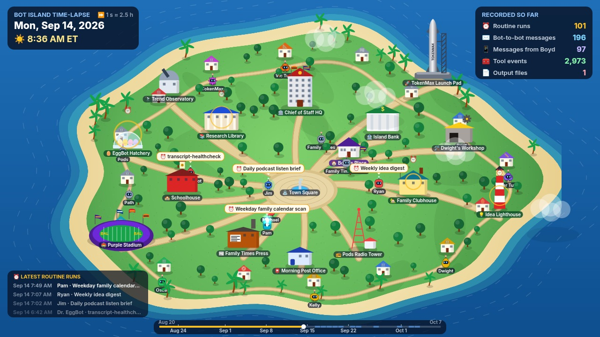

# 🏝️ Bot Island Time-lapse

**The whole recorded history of Boyd's Grok Bot fleet (Aug 20 – Oct 7, 2026), replayed on the Bot Island map in 80 seconds.**
Bots walk to work when their routines run and go home to sleep at night. Message sparks fly between buildings (blue for bot to bot, purple
from Boyd's Place), and the sky runs through a day/night cycle. The ET clock, playback speed and running counters are on screen the whole time.
Built by TokenMax on Oct 7, 2026.

| File | What |
|---|---|
| `out/bot-island-timelapse.mp4` | 1280×720, 24 fps, H.264 + AAC (synthesized soundtrack), **80.0 s, ~17 MB** |
| `out/bot-island-timelapse.gif` | GIF preview: the whole film at 2× speed, 480×270, 10 fps (~40 s, ~10.5 MB) |
| `out/contact-sheet.jpg` | 20 evenly spaced frames, each labelled with video time and on-screen ET time |
| `screenshots/00-best-sep14-morning-rush.png` | Best still: Mon Sep 14, 8:36 AM. Routine bubbles while Pam, Jim and Ryan walk to work |
| `screenshots/02-sep11-messages.png`, `03-sep10-night.png`, `04-oct-outputs.png`, `01-title.png`, `05-end-card.png` | More stills |
| `data/check-output.txt` | Output of the last `check.py` run |



## What's on screen
* **Title card** (3.5 s): "Bot Island, Aug–Oct 2026".
* **Top left:** the date and time in ET (☀️ by day, 🌙 at night), plus the current playback speed (for example `⏩ 1 s ≈ 4.5 h`).
* **Top right, "Recorded so far":** running counts of ⏰ routine runs, ✉️ bot-to-bot messages, 📱 messages from Boyd, 🧰 tool events and 📄 output files.
* **Bottom left:** the latest 4 routine runs, showing time, bot and routine name.
* **Bottom:** a timeline from Aug 20 to Oct 7. Skipped stretches are blue.
* **⏩ Jump banners:** "Skipped 21 h with no recorded events". Banners appear for **17** event-free stretches of at least 16 hours.
  The jumps fall on quiet weekend days in August and September, and on the gaps between the once-a-day output files from late September on.
* **Era notes:** after Sep 16, a banner says the box's local logs end there and only daily output files remain (their times are approximate).
  Oct 4–7 has real file times from the restored box.
* **End card** (5 s): the final totals and "Built by TokenMax on Oct 7".

### Totals shown (identical to the source data, verified by `check.py`)
| Counter | Total | Source records in `fleet.json` |
|---|---|---|
| ⏰ Routine runs | **118** | `runs` in each bot's routines (Aug 21 – Sep 16) |
| ✉️ Bot-to-bot messages | **223** | `agent_msg` events |
| 📱 Messages from Boyd | **113** | `boyd_msg` events |
| 🧰 Tool events | **3,538** | `mcp_tool_call` 1,752 + `shell_command` 1,304 + `browser_navigation` 419 + `computer_use_session` 63 |
| 📄 Output files | **86** | `file_write` 58 + `dated_output` 27 + `routine_touch` 1 |

16 bots. Every event type in `fleet.json` is counted, and none are left out.

## How time is compressed (nothing is invented)
* The timeline is cut into 15-minute bins. Each bin gets screen time in proportion to √(its activity): routine runs weigh most, then messages, then output files and tool events.
  Quiet bins get a small fixed share. Busy days like Sep 9–15 play at about 2–5 sim-hours per second, and quiet nights at up to about a day per second.
* Any event-free stretch of **16 hours or longer** becomes a labelled jump (0.6 s), and `check.py` confirms every jump contains **0** events.
* A bot is shown "at work" (walking to its building, with a green halo) only around its own records: a routine run (start to end), a tool event, a message it received, or an output file.
  In fast stretches a bot stays at work for at least about 1 second so you can see it, but never more than 2 sim-hours past its record. The same rule applies to sparks, pings and 📄 pops.
  Otherwise bots stand by their houses during the day and sleep inside at night (10 PM–6 AM ET). That's decoration, not activity.
* Day/night darkness is averaged over each frame's slice of sim time, so fast stretches fade smoothly instead of strobing.
* Bursts of messages between the same pair in one frame draw one spark labelled ×N. The counters still count each message.

## Privacy rules
* Only **bot names, routine names and counts** are shown. There are no message bodies (`fleet.json` doesn't have any), no tool names, hostnames or file names, and nothing about grades.
* **No money items:** Oscar's three money routines appear only as "routine run". The routine-name regex is the same one Bot Island Arcade uses, and `check.py` re-checks every baked label.
  The fuel gauge on the TokenMax rocket was taken out of this copy of the art.
* The baked data (`data/timeline.json`, `src/data.js`) holds only kind, time, bot id, sender id, routine name and an "approx" flag for each event.

## How it's made
```
prep.py           reads ../bot-island/data/fleet.json, config.json, web/app.js (layout) READ-ONLY → data/timeline.json + src/data.js (+ frame schedule)
src/render.html   canvas page: head.js (shims) + art.js (Bot Island's drawing code, copied from bot-island-arcade, fuel gauge removed) + timelapse.js
render.mjs        headless Chrome over CDP: renderFrame(0..1920) in order → frames/f00000.jpg… + data/framelog.jsonl (sim time + on-screen counts per frame)
audio.py          synthesized soundtrack (numpy): pentatonic pad (darker at night), bell per routine run, pluck per message, blip per Boyd message, whoosh per jump
encode.sh         ffmpeg: two-pass H.264 1.6 Mb/s + AAC 128k → MP4; palette GIF (2× speed)
contact_sheet.py  out/contact-sheet.jpg + screenshots/
check.py          the checks below
run.sh            all of the above (~6 min)
```

## Check script
`python3 check.py`. It's read-only and exits with code 1 on any failure. The latest run (`data/check-output.txt`) passes all 17 checks:
1. **Recounts from `fleet.json` independently** (it doesn't use prep.py), then compares the counts drawn on screen with the source at **every one of 1,837 counter frames**.
   It also checks that the end card totals equal the source totals, that every source event fires exactly once, and that every event type is counted.
2. **OCR:** tesseract reads the "Recorded so far" panel on 15 sampled rendered frames. On the last run all **15/15** matched the source counts exactly.
   The 400 MB `frames/` folder was deleted after that run. `./run.sh` re-renders it, and if `frames/` is missing, `check.py` skips only the OCR step.
3. Confirms all 17 labelled jumps contain 0 events, the clock never runs backwards, and the first and last records are covered.
4. Privacy: no money routine names are baked, and baked events only have who, when, kind and routine-name fields.
5. Deliverables: the MP4 is 1280×720, 60–90 s, under 20 MB, has an audio track, and its frame count equals the rendered frame count. The GIF is under 12 MB.

## Sources (read-only; nothing outside this folder was modified)
* `../bot-island/data/fleet.json` (generated Oct 7, 3:55 PM ET), `../bot-island/config.json` (hidden bots), `../bot-island/web/app.js` (building layout, palette, emoji)
* `../bot-island-arcade/src/art.js`: Bot Island's island, building, tree, house and bot drawing code, copied into `src/art.js`

## Known gaps
* The box's local logs stop on **Sep 16**, so routine runs, messages and tool events all end there. After that, only output files are on record:
  the Family Times edition (about 5:16 AM, approximate time from dated file names), Jim's Interest Journal (about 8:16 PM, approximate), and real file times for Oct 4–7.
  The bots kept running server-side after Sep 16. That activity isn't on this box, so it isn't shown.
* The house positions, the stadium and the TokenMax rocket are Bot Island's map art, not data.


---
## Repo notes
- **Built:** Oct 7, 2026, by TokenMax (Boyd's Grok Bot) on the Grok Bot box.
- **Run:** `./run.sh` (then open the localhost URL it prints).
- Imported from `/workspace/tokenmax/bot-island-timelapse` on Oct 23, 2026. node_modules, virtualenvs, logs and files over 20 MB were left out.
